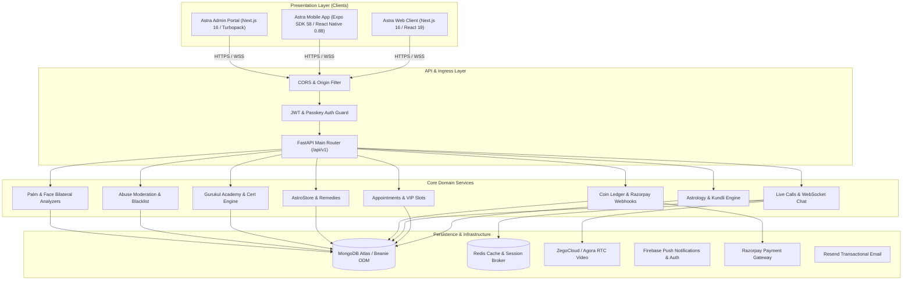

# Repository Architecture Map & End-to-End Request Flows

**Audit ID:** AUD-20261124-001  
**Generated At:** 2026-11-24T11:30:00+05:30  
**Target Project:** Astra Astrology Full-Stack Platform  

---

## 1. System Topology Diagram (Mermaid)

---

## 2. Cross-Layer Flow Analysis

### 2.1 Web & Mobile Client to Service Tracing
1. **Authentication & Session:**
   - Client (`(auth)/login` or Passkey) $\to$ `POST /api/v1/auth/login` $\to$ Pydantic validation $\to$ Password hash verification / WebAuthn signature $\to$ JWT access & refresh token issuance $\to$ Secure storage (`SecureStore` on mobile, HTTP-only / local storage on web).
2. **Consultation & Booking:**
   - Discovery (`/astrologers` or `/appointments/private/[code]`) $\to$ `GET /api/v1/appointments/private-slot/{code}` $\to$ Slot validation $\to$ Wallet deduction (`POST /api/v1/appointments/book`) $\to$ Multi-collection atomic balance check $\to$ Appointment record created $\to$ Push notification triggered via Firebase.
3. **Live WebRTC Consultation:**
   - Call room initialization (`call/[id]`) $\to$ `POST /api/v1/calls/{id}/join` $\to$ ZegoCloud / Agora token signing $\to$ RTC media negotiation $\to$ Heartbeat pings via WebSocket $\to$ Coin deduction per minute via Celery/Background task.
4. **Bilateral Palm & Face Reading:**
   - Dual image capture $\to$ `POST /api/v1/palm-reading/dual-match` or `POST /api/v1/face-reading/couple-match` $\to$ Computer Vision feature extraction $\to$ Bilateral synastry scoring $\to$ Database persistence in `PalmReading` / `FaceReading` $\to$ PDF report generation.

### 2.2 Admin Panel & Governance Tracing
1. **Safety & Abuse Moderation:**
   - Admin navigates to `/abuse-reports` $\to$ `GET /api/v1/admin/abuse-reports` $\to$ Role check (`require_admin`) $\to$ Aggregates fetched $\to$ Admin clicks "Unblock" or "Review" $\to$ `POST /api/v1/admin/abuse-reports/{id}/unblock-client` $\to$ Blacklist removed $\to$ Audit log recorded.
2. **Rules Engine Management:**
   - Admin navigates to `/palm-rules` or `/face-rules` $\to$ `GET /api/v1/admin/palm-reading/rules` $\to$ Full rule definition CRUD $\to$ Real-time engine updates without server restart.

---

## 3. Boundary & Coupling Vulnerabilities

1. **Astrologer Model Indexing Deficit (COLLSCAN Vulnerability):**
   - The primary `Astrologer` document (`app/models/astrologer.py`) lacks custom indexes on `user_id` and `slug`. As the directory scales, listing queries and booking lookups will degrade linearly in performance without index support.
2. **Rate Limiting Boundary Void:**
   - Public authentication endpoints (`/api/v1/auth/login`, `/api/v1/auth/otp`) communicate directly with database lookup queries without an intermediate IP/account rate limiter (e.g. `slowapi` or Redis token bucket).
3. **Client-Side Privacy Boundary Asymmetry:**
   - Sensitive consultation video calls on mobile have `expo-screen-capture` imported, but teardown and entry lifecycle hooks must strictly enforce `preventScreenCaptureAsync()` to match medical/financial privacy standards.
